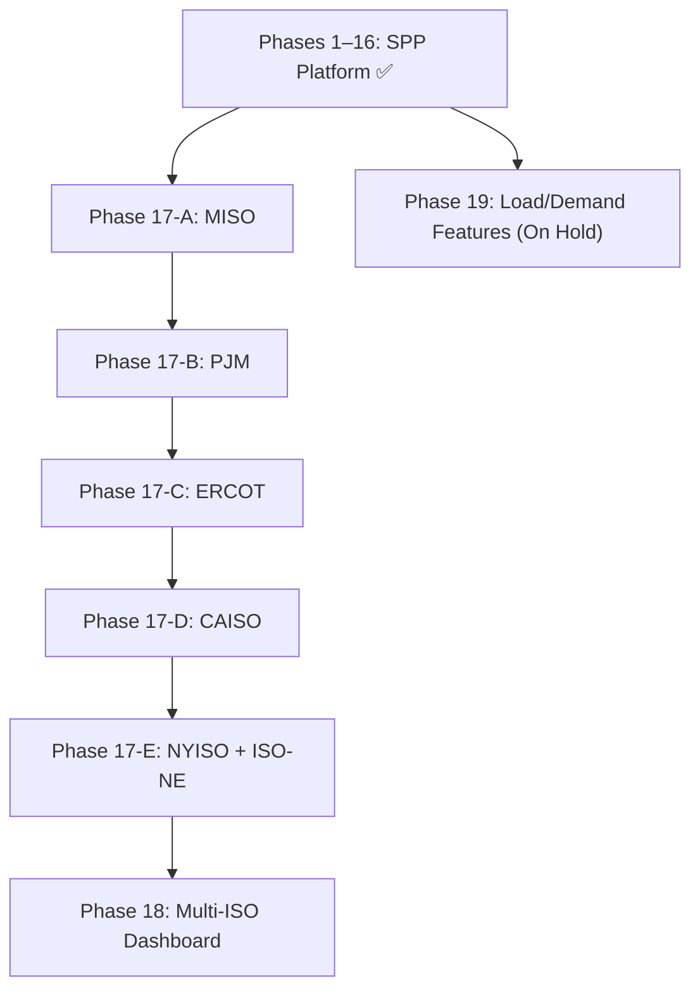

# Implementation Plan — Transmission Congestion Trading Platform

> **Scope:** SPP (live) → Multi-ISO expansion (MISO, PJM, ERCOT, CAISO, NYISO, ISO-NE)

---

## Architecture Overview

```
                      ┌──────────────────────────────────┐
                      │       ISO Data Portals           │
                      │  SPP · MISO · PJM · ERCOT · ...  │
                      │  (RTBM BC + LMP, every 5 min)    │
                      └──────────────┬───────────────────┘
                                     │ polling / REST API
                      ┌──────────────▼───────────────────┐
                      │    ISO Adapter Layer             │
                      │  spp_adapter / miso_adapter /    │
                      │  pjm_adapter / ercot_adapter...  │
                      │  (normalize to common schema)    │
                      └──────────────┬───────────────────┘
                                     │
                      ┌──────────────▼───────────────────┐
                      │     Ingest Worker (asyncio)      │
                      │  scrapers → normalizer →         │
                      │  SF solver → DuckDB store        │
                      └──────────────┬───────────────────┘
                                     │
         ┌───────────────────────────▼──────────────────────────┐
         │              FastAPI Server                          │
         │  REST + WebSocket + Forecast + Portfolio + Replay    │
         └──────────┬───────────────────────────┬──────────────┘
                    │                           │
       ┌────────────▼──────────┐   ┌────────────▼──────────────┐
       │   Trading Dashboard   │   │   Algo Execution Engine   │
       │   (HTML/JS/Leaflet)   │   │   (JSON stream consumer)  │
       └───────────────────────┘   └───────────────────────────┘
```

---

## Status Legend
- ✅ **Complete** — built and running in production
- 🟡 **Partial** — scaffolded or partially working
- ⏳ **In Progress** — currently running/building
- ❌ **Not Started** — scoped but not yet built

---

## Phase 1–8 — Core Analytics Engine ✅ COMPLETE

| Component | Status | Notes |
|---|---|---|
| `ShiftFactorCalculator` (OLS regression) | ✅ | Cross-interval least-squares, multi-constraint |
| `ConstraintNameNormalizer` | ✅ | Fuzzy matching to canonical names |
| `ConstraintRegistry` (SQLite) | ✅ | Persistent name → location mapping |
| `ConstraintLocator` (EIA GeoJSON) | ✅ | Fuzzy match to physical lines |
| `Pipeline` CLI | ✅ | End-to-end batch processing |
| `sf_exposure`, `compute_mcc()`, `flow_impact()` | ✅ | On `ShiftFactorSolution` |
| `RTConstraintsScraper` + `DAConstraintsScraper` | ✅ | Captures `limit_mw`, `monitored_mw`, `pct_of_limit` |
| Unit tests | ✅ | 70/70 passing |

---

## Phase 9 — FastAPI Server ✅ COMPLETE

| Component | Status |
|---|---|
| `src/api/server.py` — FastAPI app factory + lifespan | ✅ |
| `src/api/ingest_worker.py` — asyncio 5-min polling loop | ✅ |
| `src/api/sf_cache.py` — in-memory SF + shadow price registry | ✅ |
| `GET /api/v1/constraints/live` | ✅ |
| `GET /api/v1/constraints/history` | ✅ |
| `GET /api/v1/shift-factors` | ✅ |
| `POST /api/v1/flow-impact` | ✅ |
| `GET /api/v1/mcc` | ✅ |
| `WS /ws/constraints` — live WebSocket push | ✅ |

---

## Phase 10 — Trading Dashboard UI ✅ COMPLETE

| Component | Status |
|---|---|
| `ui/index.html` — five-panel SPA (Live / What-If / Forecast / Portfolio / Replay) | ✅ |
| `ui/js/constraints_table.js` — live sortable constraint table | ✅ |
| `ui/js/grid_map.js` — Leaflet map, SPP GeoJSON, loading % heatmap | ✅ |
| `ui/js/sf_panel.js` — shift factor bar chart per constraint | ✅ |
| `ui/js/flow_impact_calculator.js` — bilateral what-if calculator | ✅ |
| FastAPI static file serving at `/` | ✅ |

---

## Phase 11 — Portfolio P&L Engine ✅ COMPLETE

| Component | Status |
|---|---|
| `src/api/routers/positions.py` — position store CRUD | ✅ |
| `src/api/models/position.py` — Pydantic models | ✅ |
| `GET /api/v1/portfolio/risk` — net MW flow + P&L rate per constraint | ✅ |
| `ui/js/portfolio_panel.js` — portfolio table, real-time P&L | ✅ |

---

## Phase 12 — DuckDB Time-Series Store + Historical Replay ✅ COMPLETE

| Component | Status |
|---|---|
| `src/storage/duckdb_store.py` — Parquet-backed columnar store | ✅ |
| `constraints/`, `lmp/`, `shift_factors/` Parquet partitions | ✅ |
| 90-day retention auto-pruning | ✅ |
| `GET /api/v1/replay/intervals` | ✅ |
| `GET /api/v1/replay/snapshot` | ✅ |
| `GET /api/v1/replay/pnl` | ✅ |
| `ui/js/replay_player.js` — DVR scrubber with speed control | ✅ |
| `scripts/backfill_history.py` — rate-limited historical pull | ✅ |

> [!NOTE]
> **Data backfill** (⏳ running): 21 days (May 6–25) of BC + LMP data via:
> - 1 daily BC aggregate file/day (`RTBM-DAILY-BC-YYYYMMDD.csv`)
> - 288 per-interval LMP files/day (`RTBM-LMP-SL-*.csv`)
> Strategy corrected after discovering per-interval BC files are not retained historically.

---

## Phase 13 — Shadow Price Forecasting ✅ COMPLETE (maturing)

| Component | Status | Notes |
|---|---|---|
| `src/analysis/shadow_price_forecaster.py` — `HistGradientBoostingRegressor` | ✅ | 18 features: time cyclical, lags, rolling stats, binding streak |
| `src/api/forecast_cache.py` — per-constraint model registry | ✅ | Background retrain every 30 min |
| `GET /api/v1/forecast/{constraint}` — next interval + horizon | ✅ | Static routes registered before dynamic to avoid FastAPI shadowing |
| `GET /api/v1/forecast/models` — model registry | ✅ | |
| `GET /api/v1/forecast/all` — all binding constraints | ✅ | |
| `POST /api/v1/forecast/retrain` — on-demand retrain | ✅ | |
| `ui/js/forecast_panel.js` — Chart.js price path + CI band | ✅ | |
| **Model quality** | ⏳ | 58 models in persistence fallback; will flip to ML once backfill completes (~20+ intervals/constraint) |

**Fallback design:** Models below 20 training rows use persistence (last observed value). This degrades gracefully until data is available.

---

## Phase 14 — LLM Constraint Resolver ✅ COMPLETE

Wire LLM (via claude-haiku) into the constraint registry for automatic name resolution.

**Scope:**
- `src/analysis/llm_constraint_resolver.py`
- Background job automatically processes the `pending_review` queue.
- LLM is provided structured information to infer from/to substations, voltage class, equipment type.
- Exposes resolved metadata to FastAPI router `routers/constraint_resolver.py`.

---

## Phase 15 — MCP Server Tool Exposure ✅ COMPLETE

Expose grid analysis tools as a Model Context Protocol (MCP) server in TypeScript (`mcp` repo) for Claude Desktop and other MCP clients.

**Registered Tools:**
- `get_shift_factors(constraint)` -> get historical or live shift factors.
- `flow_impact_calculator(source, sink, mw, constraint)` -> bilateral MW flow impact.
- `portfolio_risk(positions[])` -> net MW flow + P&L rate.

---

## Phase 16 — Near-Binding Monitored Flowgates & Loading Volatility Alerts ✅ COMPLETE

Identify and flag transmission lines that are close to their limit *before* they bind, and track real-time loading volatility.

**Scope:**
- Compute real-time 2-hour rolling standard deviation of loading percentage (`volatility_score`).
- Extend scrapers to retrieve monitored constraints and flag those loading at >= 85% capacity with an orange hazard indicator.
- Front-end integration: Volatility column in the dashboard table, orange highlight rows, thicker Leaflet polylines on the map, and upgraded counts in the header badges.

---

## Phase 17 — Multi-ISO Expansion ❌ PLANNED

Extend the platform to all major US wholesale electricity markets.

### Feasibility Assessment

| ISO | Market Structure | Data Access | Shift Factor Approach | Build Priority |
|---|---|---|---|---|
| **MISO** | Nodal, 5-min RTBM | Public REST API | ✅ Identical to SPP | **1** |
| **PJM** | Nodal, 5-min RT + hourly DA | DataMiner2 API | ✅ Direct port | **2** |
| **ERCOT** | Nodal (since 2010), 15-min | Public portal | ✅ SCED shadow prices | **3** |
| **CAISO** | Nodal, 5-min | OASIS REST (XML) | ✅ Direct port | **4** |
| **NYISO** | Nodal, 5-min | Public CSVs | ✅ ~500 nodes | **5** |
| **ISO-NE** | Nodal, 5-min | ISONE WebServices | ✅ Free registration | **6** |
| Northwest (BPA/NWPP) | Bilateral | Limited public | ❌ No shadow prices | Deprioritized |
| Southeast (SERTP/SEEM) | Bilateral | Very limited | ❌ No nodal LMPs | Deprioritized |
| Southwest (WestConnect ex-CAISO) | Bilateral | Very limited | ❌ No shadow prices | Deprioritized |

> [!NOTE]
> The three bilateral regions lack public shadow price + nodal LMP data. The statistical SF approach requires both. Deprioritized unless SEEM or similar markets mature further.

### Architecture: ISO Adapter Pattern

Single server, ISO-namespaced — avoids duplicate infrastructure while allowing per-ISO differences.

```
src/
  adapters/
    base_adapter.py       # Abstract: fetch_constraints(), fetch_lmp(), normalize()
    spp_adapter.py        # ✅ Refactor from current scrapers
    miso_adapter.py       # Phase 17-A
    pjm_adapter.py        # Phase 17-B
    ercot_adapter.py      # Phase 17-C
    caiso_adapter.py      # Phase 17-D
    nyiso_adapter.py      # Phase 17-E
    isone_adapter.py      # Phase 17-E

src/data/timeseries/
  spp/constraints/    spp/lmp/
  miso/constraints/   miso/lmp/
  pjm/constraints/    pjm/lmp/
  ...
```

**API namespacing:**
```
GET /api/v1/{iso}/constraints/live
GET /api/v1/{iso}/forecast/{constraint}
GET /api/v1/{iso}/shift-factors
POST /api/v1/{iso}/flow-impact
```

**ISO-agnostic components (reuse as-is):**
- `ShiftFactorCalculator` — pure math, no ISO specifics
- `ShadowPriceForecaster` — feature engineering is ISO-agnostic
- `DuckDBStore` — add `iso` partition column
- `ForecastCache` — parameterize by `(iso, constraint)`
- All UI panels — add ISO selector dropdown

**ISO-specific components (new per ISO):**
- Adapter class (URL patterns, column names, auth)
- Interval alignment (PJM hourly DA + 5-min RT; ERCOT 15-min settlement)
- Shadow price field name mapping

### Per-ISO Notes

**MISO** — `api.misoenergy.org/MISORTWDDataBroker/` — nearly drop-in for SPP adapter; 5-min intervals; BC + LMP both public

**PJM** — DataMiner2 API (`dataminer2.pjm.com`) — best-documented API of all ISOs; `rt_transmission_constraints` dataset has shadow prices; 5-min RT

**ERCOT** — `ercot.com/mp/data-products/` — SCED outputs include constraint shadow prices; 15-min settlement intervals; Texas-only jurisdiction

**CAISO** — OASIS API (`oasis.caiso.com`) — XML responses (add `lxml`); `PRC_LMP` for nodal prices; `ENE_SLRS` for binding constraint shadow prices; 5-min

**NYISO** — public CSVs (`mis.nyiso.com`) — clean schema; ~500 nodes; 5-min RT; zonal + nodal LMPs

**ISO-NE** — ISONE WebServices (`webservices.iso-ne.com`) — free registration (no cert); nodal LMP + congestion component; 5-min RT

---

## Phase 18 — Multi-ISO Dashboard & ISO Selector ❌ PLANNED

Consolidate all ISO inputs into the central web UI, allowing traders to toggle between networks or view a master list of all constraints crossing high-value interties.

**Scope:**
- UI panels: add network dropdown (SPP / MISO / PJM / ...).
- Auto-refresh endpoints dynamically parameterized by active ISO.

---

## Phase 19 — Load/Demand Feature Enrichment 🛑 ON HOLD

SPP publishes demand scheduling and load forecasts, but behind market participant authentication (OATI x.509 certificate). Access is currently deferred due to credentials acquisition timeline.

**High-value datasets once credentialed:**

| Dataset | Signal | Frequency |
|---|---|---|
| STLF (Short-Term Load Forecast) | SPP's own 5-min load prediction — directly proxies system stress | 5-min |
| Hourly Load by LBA | Locational demand; maps load buildup to congestion location | Hourly |
| Gen Mix (wind/solar actuals) | Wind swings are primary driver of SPP congestion | 5-min |
| DA Clearing Prices | Leading indicator of expected RT binding constraints | Hourly |

**Integration plan:**
1. `src/scrapers/spp_load_scraper.py` + `spp_genmix_scraper.py`
2. Store in `timeseries/load/` + `timeseries/genmix/` Parquet partitions
3. Extend `ShadowPriceForecaster.build_features()` to join load + genmix
4. Auto-retrain — expected meaningful MAE reduction on wind-driven congestion events

---

## Delivery Roadmap



## Full Effort Summary

| Phase | Deliverable | Status | Est. Effort |
|---|---|---|---|
| 1–8 | Core analytics engine | ✅ Complete | — |
| 9 | FastAPI server + ingest worker | ✅ Complete | — |
| 10 | Trading dashboard UI | ✅ Complete | — |
| 11 | Portfolio P&L engine | ✅ Complete | — |
| 12 | DuckDB store + historical replay | ✅ Complete | — |
| 13 | Shadow price forecaster (ML) | ✅ Built / ⏳ Maturing | Awaiting backfill |
| 14 | LLM constraint resolver (mcp-agent) | ✅ Complete | — |
| 15 | MCP server tool exposure (TypeScript) | ✅ Complete | — |
| 16 | Near-binding flowgates & volatility alerts | ✅ Complete | — |
| 17-A | MISO adapter + data layer | ❌ | ~3 days |
| 17-B | PJM adapter + data layer | ❌ | ~3 days |
| 17-C | ERCOT adapter + data layer | ❌ | ~4 days |
| 17-D | CAISO adapter + data layer | ❌ | ~4 days |
| 17-E | NYISO + ISO-NE adapters | ❌ | ~4 days |
| 18 | Multi-ISO dashboard + ISO selector | ❌ | ~3 days |
| 19 | Load/demand feature enrichment | 🛑 On Hold | ~1 day (de-prioritized) |

---

## Open Questions

1. **Multi-ISO Priority**: Start with MISO (easiest) or PJM (highest commercial value)?
2. **Authentication**: Does the API need auth (API keys, JWT) before external exposure?
3. **ERCOT Interval Resolution**: 15-min settlement vs 5-min intraday — keep native or upsample for the SF solver?
4. **SPP Credentials**: OATI x.509 cert status for load/demand data (On Hold).

---

## Data Flow Reference (Current — SPP)

```
SPP Portal
  RTBM-DAILY-BC-YYYYMMDD.csv    → constraints/ parquet  (1 req/day, backfill)
  RTBM-LMP-SL-YYYYMMDDhhmm.csv → lmp/ parquet          (288 req/day, backfill)
  Live RTBM-BC-*.csv (5-min)    → ingest_worker (live, every 5 min)
  Live RTBM-LMP-SL-*.csv        → ingest_worker (live, every 5 min)
                                          ↓
                              ShiftFactorCalculator.fit()
                              OLS: MCC[node,t] = Σ SF[node,c] × ShadowPrice[c,t]
                                          ↓
                              shift_factors/ parquet  ← our computed output
                                          ↓
                              ShadowPriceForecaster.fit()
                              HistGradientBoosting on 18 features
                                          ↓
                              /api/v1/forecast/{constraint}
```

> [!IMPORTANT]
> Shift factors are **computed by us** from market data via OLS regression — not downloaded from SPP. SPP does not publish PTDFs publicly. LMP (MCC component) is the dependent variable; shadow prices are regressors; shift factors are the solved coefficients.
